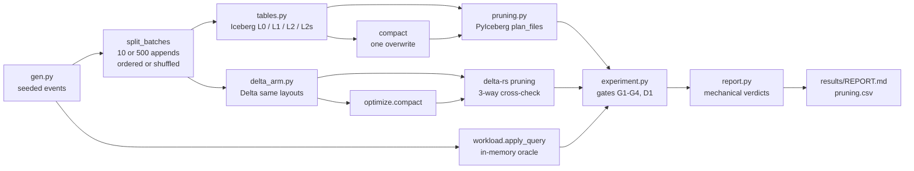

# lakehouse

> How much does an Iceberg table's layout change what a query has to read? A fixed event table
> and a fixed six-query workload, written under three layouts and two ingest regimes, with every
> file and byte the scan planner keeps counted from table metadata and every result checked
> against an in-memory oracle. A Delta Lake arm runs the same workload for comparison.

[](https://github.com/Prithv122/lakehouse/actions/workflows/ci.yml)

**Live demo:** not deployed — runs locally. **The MinIO / S3 path has been smoke-tested only** (two round-trip tests, 2026-10-24; see §6).
**Stack:** Python 3.13 · PyIceberg 0.12 (SQL catalog on SQLite) · delta-rs (`deltalake` 1.6) ·
pyarrow · numpy · uv · pytest · ruff · MinIO compose file (smoke-tested)

---

## 1. The problem

A folder of Parquet files has no transactions, no history and no cheap schema change, and a
stream of small appends leaves thousands of tiny files behind. Table formats like Apache Iceberg
and Delta Lake fix that, but how much a query actually reads still depends on layout choices:
how the table is partitioned, how rows are ordered inside files, and when small files are
compacted. Those choices are usually made from blog advice. This project measures them on one
table and one workload, with the decision rules written down before any measurement.

## 2. The data

| | |
|---|---|
| Source | Seeded generator in `src/lakehouse/gen.py` (seed 35) |
| Shape | `event_id, user_id, event_ts, event_name, channel, platform, amount`; `country` added in schema v2 |
| Size | 5,000,000 rows for the reported run, 30 days; 1,200 rows in CI |
| Skew | user ids drawn with P(k) ∝ k^-1.1 over 250,000 users; diurnal hour weights; amounts only on purchases |
| Licence | Synthetic, MIT with the code |

**The data are synthetic.** The skew and the diurnal shape are assumptions chosen to look like a
product event log; a real log will differ, and every number below is about this table.

## 3. Architecture



| Piece | Role |
|---|---|
| `spec.py` | Schema, layouts, regimes and the six queries. Frozen by `PREREGISTRATION.md` |
| `catalog.py` | PyIceberg SQL catalog (SQLite) over a local directory (tested) or `s3://` on MinIO (two round-trip tests pass; not used for any result) |
| `tables.py` | Create a layout, append batches, time travel, add a column, compact |
| `workload.py` | Queries as Iceberg and Arrow expressions; an oracle that shares no code with the engine path; canonical fingerprints |
| `pruning.py` | Files, bytes and records the planner keeps, from manifests and footers only |
| `delta_arm.py` | The same layouts and workload on Delta, with delta-rs's own pruning |
| `experiment.py` | Builds every cell (in worker processes with `--jobs`), runs every query, checks every gate |
| `report.py` | Applies the pre-registered decision rules and renders `results/REPORT.md` |
| `contract.py` | `open_table`, `snapshots`, `to_arrow`: the interface the data-quality project reads |

## 4. Key decisions and tradeoffs

- **Metadata, not stopwatches.** The main metric is what the scan planner keeps: data files,
  bytes and records after partition and min/max pruning, read from manifests. It is
  deterministic (a test runs the grid twice, once in parallel, and compares) and it is what a
  reader would fetch from object storage. Wall-clock time is an optional local extra.
- **The engine's planner, not mine.** Iceberg numbers come from PyIceberg's `plan_files()`.
  Delta numbers come from delta-rs's stats guarantees on pyarrow dataset fragments, and are
  cross-checked against delta-rs's native `file_uris(file_pruning_predicate=...)` and a separate
  stats evaluator (check D1).
- **An oracle that shares nothing with the engine path.** Every query result in every cell must
  equal the oracle's (gate G1), compared by SHA-256 of a canonical form. Q6 sums amounts as
  integer cents so the sum cannot depend on row order.
- **Two arrival orders.** Appending in time order already gives an unpartitioned table tight
  `event_ts` ranges per file, so it prunes date queries without any partitioning. Shuffled
  arrival is the contrast that shows what partitioning itself buys.
- **Sorting is done by the writer, because PyIceberg does not.** A table's sort order is
  metadata only in PyIceberg 0.12; L2 sorts each batch before appending.
- **Compaction is a full rewrite.** PyIceberg 0.12 has no `rewrite_data_files`, so compaction is
  one `overwrite` transaction (one metadata commit, two snapshots: an empty DELETE, then the
  APPEND). Old snapshots keep their files, so time travel across it still works (gate G2).
- **Pre-registered, then amended in the open.** A review's dry run showed the registered H1/H2
  rules count files written, not files pruned. The original verdicts are kept; a bytes-only
  reading was added as a labelled secondary result (`PREREGISTRATION.md`, Amendment 1).

## 5. Results

5,000,000 synthetic rows, seed 35, PyIceberg 0.12.0 / deltalake 1.6.6 / pyarrow 25.0.1, Windows
11, run at commit `dbc2dda` on 2026-10-23 (56 minutes, 5 worker processes). All numbers are
copied from [`results/REPORT.md`](results/REPORT.md), which the code writes; the full per-cell
table is [`results/pruning.csv`](results/pruning.csv). Bytes are Parquet bytes the planner keeps
after partition and min/max pruning, not bytes a reader finally decodes. **They are I/O
estimates from metadata on synthetic data, not runtime speedups;** no query was timed.

**Correctness gates: all passed.** G1 528/528 query results equal the oracle; G2 176 time-travel
reads exact; G3 adding `country` rewrote 0 data files; G4 compaction lost no row; D1 the three
Delta pruning counts agreed on all 144 checks.

### Verdicts

| Hypothesis | Ordered arrival | Shuffled arrival |
|---|---|---|
| **H1** (registered): day partitioning plans fewer files *and* bytes for date queries | not supported | not supported (registered expectation was "supported") |
| **H1b** (Amendment 1, bytes only, defined after a dry run) | supported, one day 2.53x fewer bytes, seven days 1.07x | supported, one day **28.2x** fewer bytes, seven days 4.04x |
| **H2** (registered): sorting by user plans fewer files for user queries | not supported | not supported |
| **H2b** (Amendment 1, bytes only) | not supported: sorted files are *bigger*, 0.84x | "supported" at 1.11x, but the same 300 files are planned and the whole sorted table is 10% smaller (70.9 vs 78.6 MiB): a size difference, not pruning (cause not isolated) |
| **H3**: compaction cuts files by >= 10x, results unchanged | supported for L0, L1, L2 (17.6x to 500x) | supported (500x; 15,000 files to 30) |

H1 fails for a reason the registration missed: day partitioning splits every append into one
file per day, so a partitioned table can never plan fewer *files* than an unpartitioned one
here, even while it reads 28 times fewer bytes. Amendment 1 kept the original verdict and added
the bytes reading in the open.

### What the numbers say

1. **Partitioning by day pays off far more when arrival order does not already cluster time**
   (28.2x vs 2.5x fewer bytes for one day).
   Appending in time order gave the unpartitioned table files with narrow `event_ts` ranges, so
   a one-day query already planned 1 of 10 files (4.6 MiB); partitioning cut that to 1.8 MiB.
   With shuffled arrival the unpartitioned table had to read everything (73.9 MiB) and the
   partitioned one read 2.6 MiB.

   | One-day query, regime B1 | L0 unpartitioned | L1 by day |
   |---|---|---|
   | Ordered arrival | 1/10 files · 4.6 MiB | 1/39 files · 1.8 MiB |
   | Shuffled arrival | 10/10 files · 73.9 MiB | 10/300 files · 2.6 MiB |

2. **Sorting by user did nothing for user queries at the default file size.** At PyIceberg's
   512 MiB target each day partition of an append is one file holding every user id, so min/max
   pruning cannot skip it. Its effect on size depended on arrival: in time order the sorted
   table was 20% larger (66.8 vs 55.8 MiB
   planned for a user lookup), most likely because timestamps compress worse once rows are
   ordered by user (the cause was not isolated); with shuffled arrival it was 10% smaller
   (70.9 vs 78.6 MiB).

3. **Sorted small files are where the user-lookup gain appeared** (no unsorted small-file
   control was run, so the two changes are not separated). With a 1 MiB target (L2s,
   measured in in-memory Arrow bytes; on disk the files average about 160 KB, 63.6 MiB in 399) each day partition splits into
   files covering disjoint user ranges. The user lookup then planned 39 of 399 files and
   **5.3 MiB instead of 55.8 MiB (10.5x less)**; the user-and-week query 1.2 vs 12.8 MiB. The
   price is ten times as many files. This is the bytes-only reading (H2b-L2s, Amendment 1); the
   registered sensitivity rule H2-L2s, which counts files, was not supported (39 vs 39 files
   planned). With shuffled arrival L2s wrote 600 files against L2's 300, so each partition split
   roughly in two, and the gain shrank to 1.43x.

4. **500 tiny appends make metadata and storage worse, and compaction fixes both.** Shuffled
   tiny appends wrote 15,000 files and 500 manifests for one 5M-row table; the user lookup
   planned 118.4 MiB. Compaction left 30 files and 1 manifest, and the same query planned
   55.9 MiB, about half.

5. **Compaction can make queries worse.** The unpartitioned table built from time-ordered
   appends, compacted into a single file, lost the time clustering those appends had given it: the one-day query
   went from 1.9 MiB planned to **40.1 MiB (21x more)**. With shuffled appends there was no
   clustering to lose, and compacting L0 improved every query (82.4 to 40.1 MiB). The
   partitioned and small-file layouts kept their pruning (one day 1.8 MiB, user
   lookup on L2s 5.2 MiB after compaction).

| Compaction, regime B2 → B2c | Files | One-day query | User lookup |
|---|---|---|---|
| L0, ordered | 500 → 1 | 1.9 → 40.1 MiB | 53.6 → 40.1 MiB |
| L1, shuffled | 15,000 → 30 | 3.9 → 1.8 MiB | 118.4 → 55.9 MiB |
| L2s, ordered | 529 → 390 | 2.1 → 2.2 MiB | 60.7 → 5.2 MiB |

### Delta Lake (descriptive)

delta-rs pruned the same way Iceberg did wherever the layouts match: one-day query on the
ordered unpartitioned table 1 of 10 files, on day partitions 1 of 39. Delta stores a derived
`event_date` partition column, and since the queries filter on `event_ts`, its date pruning came
from min/max statistics, not partition values. Its files were larger for the same rows (71.2 vs
45.8 MiB for the ordered unpartitioned table); the default codecs differ (not isolated here).
delta-rs's `target_file_size` counts different bytes from PyIceberg's, so "L2s" split ordered
partitions into 129 files rather than 399 and did not split shuffled ones at all; the Delta L2s
column is therefore not the same layout as Iceberg's.

### Limits

Synthetic data with a chosen skew; one machine; local filesystem. Planned bytes are what the
planner allows a reader to fetch, not query time; no wall-clock numbers are reported. PyIceberg
is not Spark: production Iceberg compacts with `rewrite_data_files`, can sort on write and may
prune differently. One seed; the metrics are deterministic for it (tested serially and in
parallel), but another skew or day count would move every ratio.

## 6. How to run

```bash
uv sync
uv run pytest
uv run lakehouse --warehouse warehouse init
uv run lakehouse --warehouse warehouse ingest --rows 50000
uv run lakehouse --warehouse warehouse time-travel
uv run lakehouse --warehouse warehouse evolve-schema
uv run lakehouse --warehouse warehouse workload-report --rows 50000 --jobs 4 --out results
```

The reported run is `workload-report --rows 5000000 --jobs 5`. `lakehouse render` rebuilds
`REPORT.md` from `results/pruning.csv` without re-running anything.

**MinIO (optional, smoke-tested).** Everything in §5 ran on the local filesystem. The S3 path was
checked once, on 2026-10-24 (Docker Desktop on Windows 11): `docker compose up -d` pulled the
pinned archived Bitnami images, started MinIO on port 9000 (console 9001, dev credentials
`minioadmin` / `minioadmin`) and created the bucket `lake` (the bucket job retries until MinIO
is up); `uv run pytest -m minio` then passed both S3 round trips, Iceberg and Delta. That is a
smoke check of reading and writing through `s3://`, not a measurement: no workload ran on MinIO,
and the images are an unmaintained archive. Then
`uv run pytest -m minio` runs the S3 round trips, and any command takes
`--warehouse s3://lake/warehouse` (Iceberg only; the catalog file stays in `./.lakehouse`).
The MinIO run is a smoke check, not part of the measurement.

## 7. What I'd change at 100× scale

- **Object storage and a real catalog.** 500 million rows means S3 or GCS with a REST or Glue
  catalog, not SQLite. The planned-bytes metric becomes a request and egress bill, so I would
  log it per query in production rather than only in an experiment.
- **Compaction as a scheduled, layout-aware job.** Result 5 is the warning: rewrite per
  partition with the table's sort order (Spark or a managed service's `rewrite_data_files`),
  never into one undifferentiated file, and run it on a small-file count threshold.
- **Choose the clustering key from the query log.** User lookups only got cheap with sorted,
  small files. At scale I'd measure which predicates dominate and use Z-order or a bucket
  partition on `user_id` instead of guessing, and re-run this harness to check the bytes.
- **Commit throughput.** Each PyIceberg commit cost roughly 0.3 s on this machine (build notes;
  timing is not part of the reported results); thousands of tiny appends
  an hour need batching upstream (a stream buffer or micro-batches) before they reach the table.
- **Snapshot expiry.** Time travel kept every old file alive; production needs a retention
  window and `expire_snapshots`, or storage grows with every compaction.

## References

- Apache Iceberg table spec (manifests, partition transforms, column metrics) and PyIceberg 0.12
  documentation.
- delta-rs (`deltalake`) documentation for `write_deltalake`, `optimize.compact` and file pruning.
