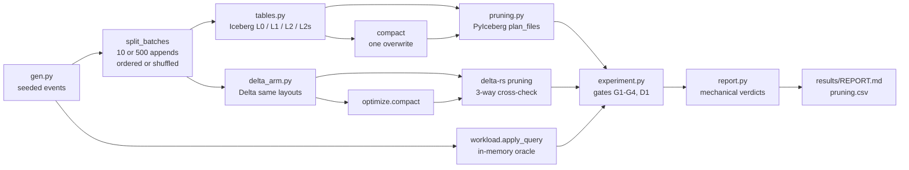

# lakehouse

> How much does an Iceberg table's layout change what a query has to read? A fixed event table
> and a fixed six-query workload, written under three layouts and two ingest regimes, with every
> file and byte the scan planner keeps counted from table metadata and every result checked
> against an in-memory oracle. A Delta Lake arm runs the same workload for comparison.

[](https://github.com/Prithv122/lakehouse/actions/workflows/ci.yml)

**Live demo:** not deployed — runs locally (and against MinIO with Docker Compose).
**Stack:** Python 3.13 · PyIceberg 0.12 (SQL catalog on SQLite) · delta-rs (`deltalake` 1.6) ·
pyarrow · numpy · MinIO · uv · pytest · ruff

---

## 1. The problem

A folder of Parquet files has no transactions, no history and no cheap schema change, and a
stream of small appends leaves thousands of tiny files behind. Table formats like Apache Iceberg
and Delta Lake fix that, but how much a query actually reads still depends on layout choices:
how the table is partitioned, how rows are ordered inside files, and when small files are
compacted. Those choices are usually made from blog advice. This project measures them on one
table and one workload, with the decision rules written down before any measurement.

## 2. The data

| | |
|---|---|
| Source | Seeded generator in `src/lakehouse/gen.py` (seed 35) |
| Shape | `event_id, user_id, event_ts, event_name, channel, platform, amount`; `country` added in schema v2 |
| Size | 5,000,000 rows for the reported run, 30 days; 1,200 rows in CI |
| Skew | user ids drawn with P(k) ∝ k^-1.1 over 250,000 users; diurnal hour weights; amounts only on purchases |
| Licence | Synthetic, MIT with the code |

**The data are synthetic.** The skew and the diurnal shape are assumptions chosen to look like a
product event log; a real log will differ, and every number below is about this table.

## 3. Architecture



| Piece | Role |
|---|---|
| `spec.py` | Schema, layouts, regimes and the six queries. Frozen by `PREREGISTRATION.md` |
| `catalog.py` | PyIceberg SQL catalog (SQLite) over a local directory or `s3://` on MinIO |
| `tables.py` | Create a layout, append batches, time travel, add a column, compact |
| `workload.py` | Queries as Iceberg and Arrow expressions; an oracle that shares no code with the engine path; canonical fingerprints |
| `pruning.py` | Files, bytes and records the planner keeps, from manifests and footers only |
| `delta_arm.py` | The same layouts and workload on Delta, with delta-rs's own pruning |
| `experiment.py` | Builds every cell (in worker processes with `--jobs`), runs every query, checks every gate |
| `report.py` | Applies the pre-registered decision rules and renders `results/REPORT.md` |
| `contract.py` | `open_table`, `snapshots`, `to_arrow`: the interface the data-quality project reads |

## 4. Key decisions and tradeoffs

- **Metadata, not stopwatches.** The main metric is what the scan planner keeps: data files,
  bytes and records after partition and min/max pruning, read from manifests. It is
  deterministic (a test runs the grid twice, once in parallel, and compares) and it is what a
  reader would fetch from object storage. Wall-clock time is an optional local extra.
- **The engine's planner, not mine.** Iceberg numbers come from PyIceberg's `plan_files()`.
  Delta numbers come from delta-rs's stats guarantees on pyarrow dataset fragments, and are
  cross-checked against delta-rs's native `file_uris(file_pruning_predicate=...)` and a separate
  stats evaluator (check D1).
- **An oracle that shares nothing with the engine path.** Every query result in every cell must
  equal the oracle's (gate G1), compared by SHA-256 of a canonical form. Q6 sums amounts as
  integer cents so the sum cannot depend on row order.
- **Two arrival orders.** Appending in time order already gives an unpartitioned table tight
  `event_ts` ranges per file, so it prunes date queries without any partitioning. Shuffled
  arrival is the contrast that shows what partitioning itself buys.
- **Sorting is done by the writer, because PyIceberg does not.** A table's sort order is
  metadata only in PyIceberg 0.12; L2 sorts each batch before appending.
- **Compaction is a full rewrite.** PyIceberg 0.12 has no `rewrite_data_files`, so compaction is
  one `overwrite` transaction (one metadata commit, two snapshots: an empty DELETE, then the
  APPEND). Old snapshots keep their files, so time travel across it still works (gate G2).
- **Pre-registered, then amended in the open.** A review's dry run showed the registered H1/H2
  rules count files written, not files pruned. The original verdicts are kept; a bytes-only
  reading was added as a labelled secondary result (`PREREGISTRATION.md`, Amendment 1).

## 5. Results

_Pending the 5,000,000-row run. Every number here will be copied from `results/REPORT.md`,
which the code writes; nothing is filled in by hand._

## 6. How to run

```bash
uv sync
uv run pytest
uv run lakehouse --warehouse warehouse init
uv run lakehouse --warehouse warehouse ingest --rows 50000
uv run lakehouse --warehouse warehouse time-travel
uv run lakehouse --warehouse warehouse evolve-schema
uv run lakehouse --warehouse warehouse workload-report --rows 50000 --jobs 4 --out results
```

The reported run is `workload-report --rows 5000000 --jobs 6`. `lakehouse render` rebuilds
`REPORT.md` from `results/pruning.csv` without re-running anything.

**MinIO (optional).** `docker compose up -d` starts MinIO on port 9000 (console 9001, dev
credentials `minioadmin` / `minioadmin`) and creates the bucket `lake`. Then
`uv run pytest -m minio` runs the S3 round trips, and any command takes
`--warehouse s3://lake/warehouse` (Iceberg only; the catalog file stays in `./.lakehouse`).
The MinIO run is a smoke check, not part of the measurement.

## 7. What I'd change at 100× scale

_Written after the results._

## References

- Apache Iceberg table spec (manifests, partition transforms, column metrics) and PyIceberg 0.12
  documentation.
- delta-rs (`deltalake`) documentation for `write_deltalake`, `optimize.compact` and file pruning.
